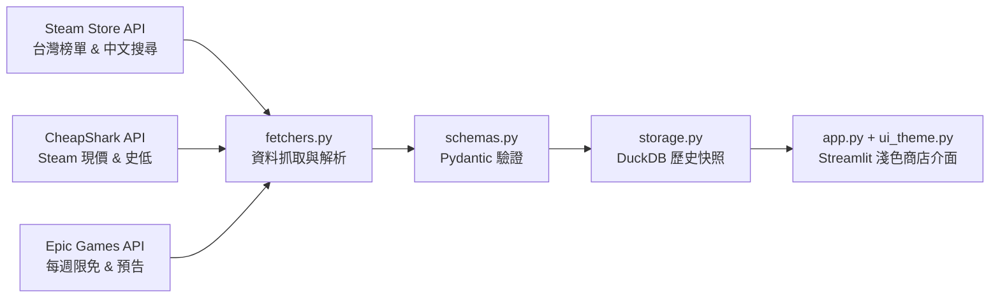

<p align="left">
  
</p>

# Game Deal Radar

一個以 **Python + DuckDB + Streamlit** 打造的 **Steam & Epic 遊戲特價、史低追蹤與每週限免情報平台**。完全串接免費公開 API（免 API Key），提供乾淨的淺色商店風格介面與本地歷史價格分析。

---

## 核心功能

* **Steam 追蹤清單（台幣計價）**：自動換算新台幣，清楚標示現價、折扣百分比、原價刪除線與歷史最低價（史低標記），並支援展開查看歷次同步的 **歷史價格折線圖**。
* **中 / 英文搜尋與快速新增**：整合 Steam 台灣區搜尋 API，直接輸入中文（如「艾爾登法環」、「空洞騎士」）或英文即可加入追蹤。
* **Epic Games 每週限免**：自動區分「本週限時免費領取（含截止日）」與「下週限免預告（含開放日）」。
* **Steam 台灣熱門榜 & 官方精選特價**：即時抓取台灣區暢銷榜與官方折扣精選，支援分批展開查看更多。
* **互動式追蹤清單編輯器**：可隨時勾選開關某款遊戲是否追蹤、修改名稱、批次新增或刪除。

---

## 系統架構



## 技術棧與工程亮點

* **資料管線與儲存**：`Python`、`httpx`、`Pydantic v2`、`DuckDB`（使用 SQL `ROW_NUMBER()` Window Function 查詢最新價格快照並保留完整歷史紀錄）。
* **前端與品牌設計**：`Streamlit` 搭配集中式 Design System（`ui_theme.py`）、原生淺色主題（`.streamlit/config.toml`）與原創向量 SVG Logo / Favicon（`assets/`）。
* **自動化品質保證**：`pytest` 離線單元測試 + **GitHub Actions CI**（每次 Push / PR 自動執行測試）。

---

## 本地啟動（Anaconda / Python）

```bash
# 1. 取得專案並安裝依賴
git clone https://github.com/<你的帳號>/game-deal-radar.git
cd game-deal-radar
pip install -r requirements.txt

# 2. 執行單元測試
pytest -v

# 3. 啟動網頁看板
streamlit run app.py
```

---

## 免費部署上線（Streamlit Community Cloud）

1. 將 `game-deal-radar/` 推送到你的 GitHub 公開 Repository。
2. 前往 [share.streamlit.io](https://share.streamlit.io/) 並使用 GitHub 登入。
3. 點擊 **Create app** → 選擇你的 Repository、Branch（`main`）、Main file path 填 **`app.py`** → 點擊 **Deploy**。
4. 約 1~2 分鐘即可取得永久公開網址，隨時在電腦或手機打開使用！

> **提示**：雲端免費環境在休眠重啟後會重置本地 DuckDB 暫存檔，打開網頁後點一次左側 **「同步最新資料」** 即可即時從公開 API 重新拉取最新特價與限免。
